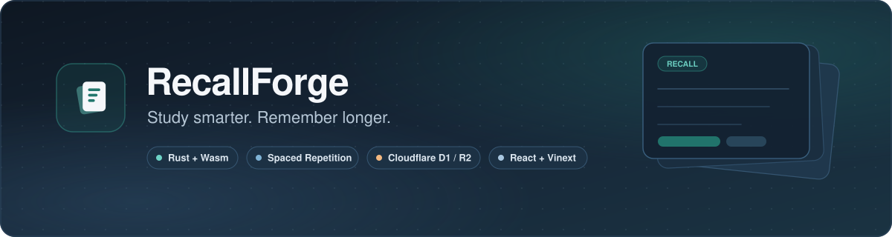
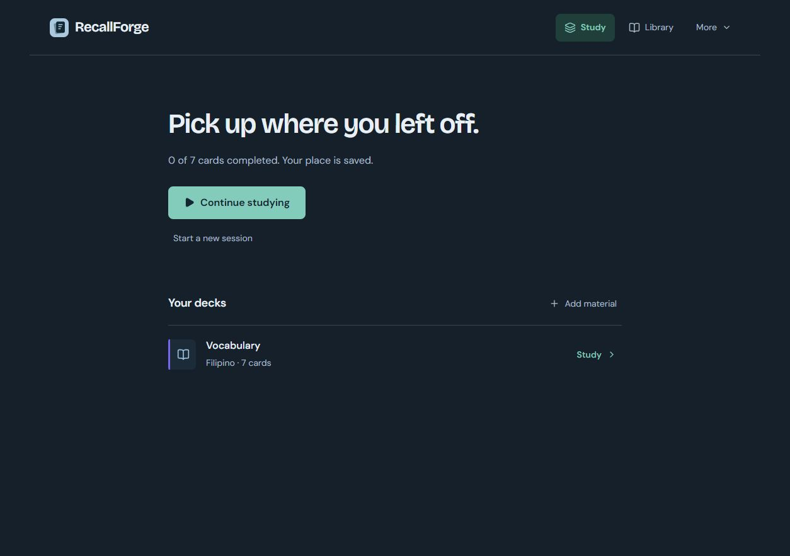
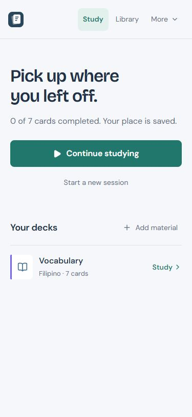
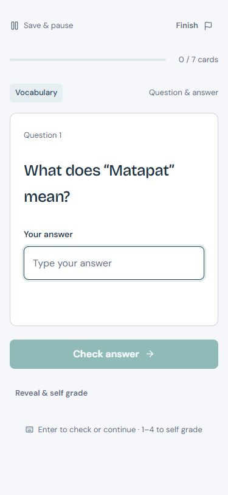
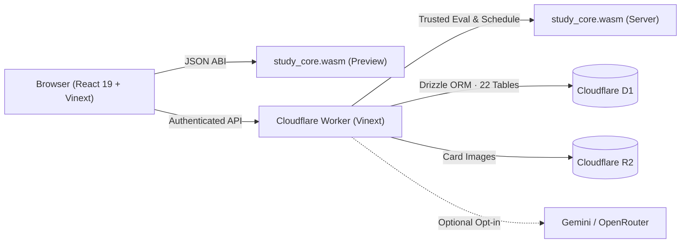

<div align="center">



<br />
<br />

[](crates/study_core)
[](tsconfig.json)
[](package.json)
[](docs/ARCHITECTURE.md)
[](https://github.com/MotoGeekops/gizmo-copy/actions/workflows/ci.yml)
[](LICENSE)

<br />

[Screenshots](#screenshots) · [Features](#features) · [Architecture](#architecture) · [Getting Started](#getting-started) · [Verification](#verification) · [Docs](#documentation)

</div>

---

**RecallForge** is a personal active-recall and spaced-repetition study application built with a **React / Vinext** interface, a shared **Rust WebAssembly** study engine, **Cloudflare D1** persistence, and **R2** image storage.

It opens straight to a quiet, study-first workspace—start or continue a session in one click, or pick a deck—while keeping deck organization, search, study modes, exams, statistics, achievements, an optional AI tutor, and settings neatly tucked into **Library** and **More**.

## Screenshots

<table>
  <tr>
    <td align="center" width="52%">
      
      <br />
      <sub><strong>Study Home (Desktop · Dark)</strong> — Resume saved sessions or pick a deck without clutter.</sub>
    </td>
    <td align="center" width="24%">
      
      <br />
      <sub><strong>Mobile Home</strong> — Responsive layout with zero horizontal overflow.</sub>
    </td>
    <td align="center" width="24%">
      
      <br />
      <sub><strong>Active Recall</strong> — Distraction-free card prompt and keyboard/touch controls.</sub>
    </td>
  </tr>
</table>

## Features

| Area | What you get |
| :--- | :--- |
| **Study modes** | Memorise, Classic flashcards, practice tests, speed rounds, weakness review, custom study, and cram practice—sessions survive page refreshes on the server. |
| **8 card formats** | Q&A, cloze deletions, multiple choice, multiple select, true/false, matching, ordering, and image cards with hints, explanations, acceptable alternatives, and source references. |
| **Rust/Wasm engine** | Answer evaluation, SM-2-inspired spaced repetition, bounded wrong-answer retries, XP deduplication, Asia/Manila daily streaks, levels, and mastery calculation. |
| **Smart Import** | On-device parsing for TXT, Markdown, CSV/TSV, JSON decks, text PDFs, DOCX, and PPTX. Includes a deterministic non-AI parser that works without any API key. |
| **Library & exams** | Subjects, folders, tags, favorites, archive & deletion recovery, deck duplication & merge, bulk card actions, search, exam decks, readiness estimates, and daily targets. |
| **Optional AI** | Opt-in server-side **Gemini** and **OpenRouter** adapters for the AI tutor and source-grounded QA generation (10 requests/day cap; disabled cleanly when unconfigured). |
| **Backups & restore** | Full versioned JSON export (`recallforge-backup` v1) with graph validation and transactional restore preserving schedules and review history. |
| **Themes & access** | Light, dark, and system themes, reduced-motion mode, safe Markdown + KaTeX math rendering, full keyboard controls, and mobile navigation. |

> [!NOTE]
> **Honest scope:** RecallForge uses a transparent **SM-2-inspired** scheduler (not FSRS). It does not include offline synchronization, PWA installation, OCR for scanned PDFs, audio/URL scraping, ads, leaderboards, or subscriptions. See the [Feature Verification Report](docs/FEATURE_VERIFICATION.md) for full details.

## Architecture

The core domain logic in [`crates/study_core/`](crates/study_core) compiles to `wasm32-unknown-unknown` with zero DOM, HTTP, or database dependencies—so the browser and Cloudflare Worker run the exact same evaluation and scheduling code.



<details>
<summary><strong>Repository layout</strong></summary>

| Path | Responsibility |
| :--- | :--- |
| [`crates/study_core/`](crates/study_core) | Rust study engine (answer evaluation, SM-2-inspired scheduling, streaks, XP, mastery) |
| [`app/`](app) | Next/Vinext page entry, layout, CSS tokens, and authenticated API routes |
| [`components/`](components) | React interface, study views, card editor, Smart Import, library, analytics |
| [`server/`](server) | Worker-side Wasm runner, D1 queries, library mutations, backups, and AI adapters |
| [`db/`](db) & [`drizzle/`](drizzle) | 22-table relational Drizzle schema and SQL migrations |
| [`lib/`](lib) | Shared TypeScript types, Wasm JSON ABI, and local PDF/DOCX/PPTX/CSV importers |
| [`tests/`](tests) | Synthetic D1/R2 integration tests and Wasm/importer verification suites |
| [`docs/`](docs) | Architecture, product spec, design direction, verification report, deployment guide |

</details>

## Getting Started

### Prerequisites

- **Node.js** `>= 22.13.0` and **npm**
- **Rust** (`stable`) with `wasm32-unknown-unknown`:
  ```powershell
  rustup target add wasm32-unknown-unknown
  ```

### 1. Install and build

```powershell
git clone https://github.com/MotoGeekops/gizmo-copy.git
cd gizmo-copy
npm ci
npm run build:rust
npm run build
```

### 2. Initialize the local D1 database

For a fresh checkout, apply the initial migration after building:

```powershell
node --import ./scripts/sites-env.mjs ./node_modules/wrangler/bin/wrangler.js d1 execute DB --local --config dist/server/wrangler.json --persist-to .wrangler/state --file drizzle/0000_round_thor.sql
```

### 3. Run locally

```powershell
npm run dev -- --port 5173
```

Open the printed loopback URL and use the local development sign-in (`local_seedy`).

### 4. Optional AI configuration

No API key is required for core study or non-AI Smart Import. To enable the AI Tutor and grounded QA generation locally, copy [`.env.example`](.env.example) to `.dev.vars` and set:

```ini
GEMINI_API_KEY=...       # Used when present
OPENROUTER_API_KEY=...   # Fallback when Gemini is absent
AI_MODEL=...             # Optional model override (defaults: gemini-2.5-flash / openrouter/auto)
```

## Verification

Latest recorded verification results cover **87 automated checks** across Rust, WebAssembly, importers, and local Worker persistence:

- **35** Rust unit tests (`cargo test`)
- **15** Wasm & document importer checks (`npm run test:wasm`)
- **37** Database, auth, backup/restore, and API integration checks (`npm run test:integration`)

```powershell
cargo fmt --check
cargo clippy --all-targets -- -D warnings
cargo test
npm run check
npm run test:wasm
npm run build
```

To run the full Worker integration suite, start the built preview server in one terminal and run the suite in another:

```powershell
# Terminal 1
npm start -- --port 5180

# Terminal 2
npm run test:integration
```

## Documentation

- [Architecture Overview](docs/ARCHITECTURE.md) — Hosting boundary, data integrity, scheduling math, and security model
- [Feature Verification Report](docs/FEATURE_VERIFICATION.md) — Verified capabilities, browser checks, and intentional omissions
- [Frontend Design Direction](docs/FRONTEND_DESIGN.md) — Typography, palette, and study-first navigation principles
- [Deployment Guide](docs/DEPLOYMENT.md) — Migrations, secrets, backups, and Sites publishing workflow
- [Product Specification](docs/PRODUCT_SPEC.md) — Complete original product specification
- [Contributing](CONTRIBUTING.md) — Local workflow and verification checklist

## License

Released under the [MIT License](LICENSE). Third-party packages, bundled fonts, and starter integration scripts retain their respective licenses under [`docs/licenses/`](docs/licenses) and [`vendor/`](vendor).
